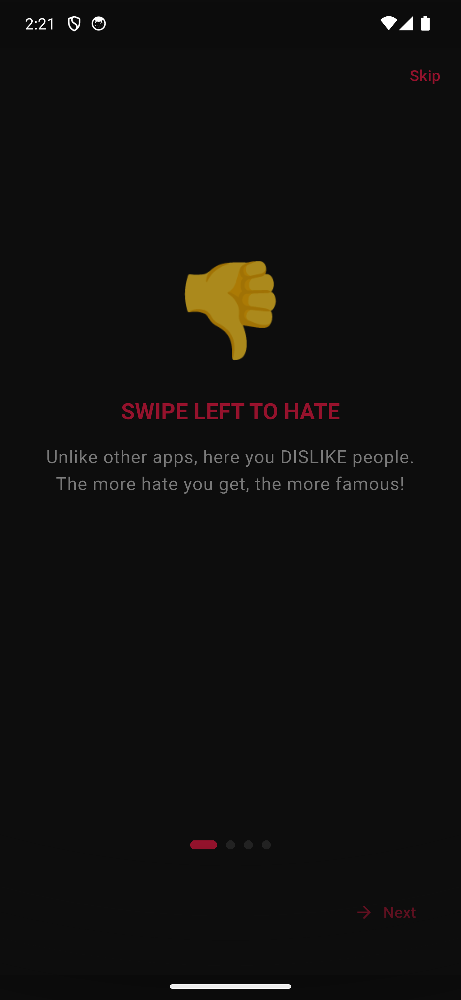
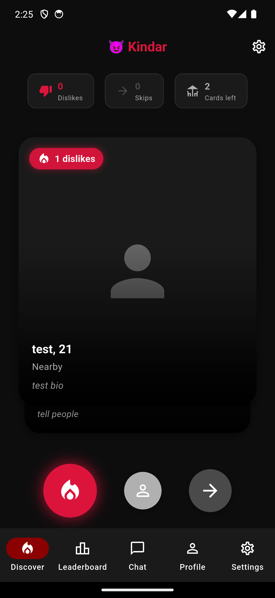
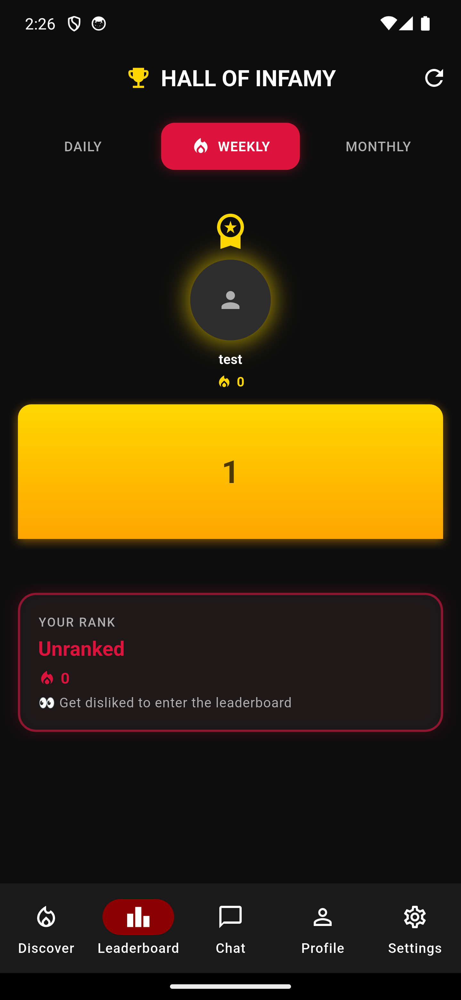
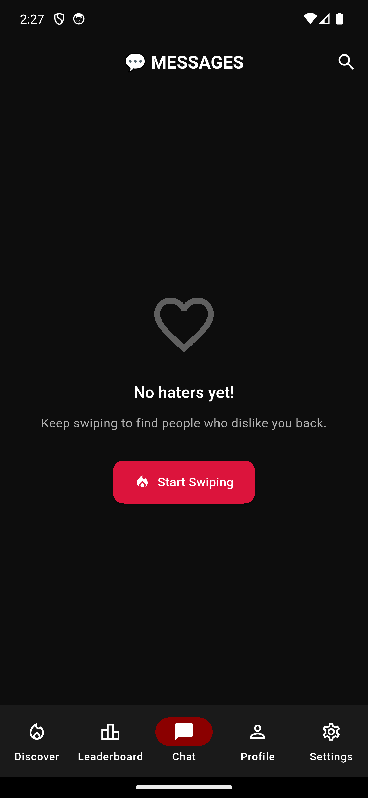
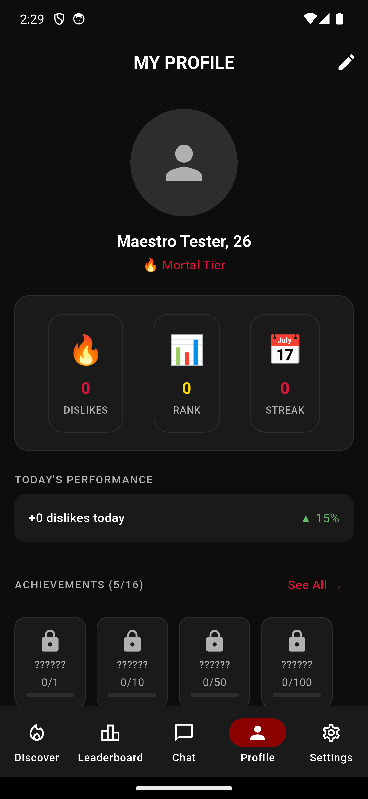
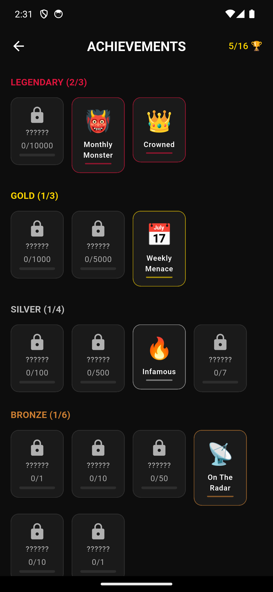

# Kındar

> **The anti-Tinder.** Get matched with people who *dislike* you the most. Collect dislikes. Become famous.

---

## 💡 The concept

Every dating app on Earth is built around the same emotional currency: getting people to *like* you. Match counts, hearts, super-likes, premium boosts — they all assume affection is what we want to maximize.

**Kındar throws that out the window.** Here's the deal:

- 👈 **Swipe left to dislike** — in Kındar that's the *positive* action. **Swipe right to skip.** There is no like button.
- 💔 **Dislikes are the score.** Every dislike you receive adds to your infamy.
- 🏆 **The Hall of Infamy ranks the most-disliked profiles** — daily, weekly and monthly, with a podium for the top three.
- 🎖️ **16 achievements in four tiers** reward milestones, from *First Blood* (your first dislike) to *Public Enemy* (1,000 dislikes) and *Legend of Hate* (10,000).
- 💬 **A mutual dislike unlocks a chat.** When two people dislike each other, a chat opens with a system greeting: *"Chat unlocked! You both disliked each other. How romantic."*

It's social media's id wearing a tuxedo: the part of the internet that already exists, except this time the metric is honest. Under the irony sits a serious safety layer: 18+ only, report and block on every profile and chat, and account deletion from inside the app.

The name is a play on the Turkish **kın** ("scorn / disapproval") + Tinder — *"the Tinder of contempt."*

## 🛠️ Tech stack

**Framework**

**State management & navigation**

**Backend, auth & messaging**

**Media**

**UI / UX**

**Testing**

## ✨ What's built

The repo intentionally ships only the project manifest (`pubspec.yaml`) and this README — the source tree stays private while the app is in development. Here is what the private codebase contains today.

### 🔑 Onboarding & sign-in
- Splash screen with a routing state machine (onboarding → sign-in → profile setup → app)
- Four-page onboarding that explains the inverted rules
- Phone number sign-in with SMS code and resend cooldown (Firebase Auth)
- Google Sign-In, and Sign in with Apple on iOS
- Profile setup: name, age (18+), bio and a cropped profile photo

### 💔 The swipe loop
- Card stack with drag physics, rotation and fly-off animations
- Dislike / view profile / skip buttons with haptic feedback
- Mutual-dislike detection that creates a match and unlocks a chat

### 🏆 Hall of Infamy
- Daily, weekly and monthly tabs
- Top-three podium and the full ranked list
- A pinned *Your rank* card with tiers: Mortal → Imp → Villain → Demon → Inferno

### 🏅 Profiles & achievements
- Your own profile with stats, photo strip (up to 6 photos) and bio
- Other users' profiles with a swipeable photo gallery
- 16 achievements across Bronze, Silver, Gold and Legendary tiers

### 📸 Photos
- Camera or gallery picker → square crop → upload to Cloudinary
- On-the-fly Cloudinary transformations for thumbnails, cards and profile photos

### 💬 Chat
- Real-time chat on Cloud Firestore with unread badges and search
- Chats grouped into *New haters* and *Conversations*

### 🛡️ Safety
- Report a user from their profile or a chat (five reasons)
- Block and unblock, with a Blocked users screen
- Account deletion from Settings, with re-authentication

### ⚙️ Settings
- Age range for discovery, haptics, log out and account deletion
- Three dark themes: Dark, Darker and AMOLED Black

### 🧪 Quality gate
- `flutter analyze` with zero issues
- 129 unit and widget tests, 16 integration tests against the Firebase Emulator Suite
- 17 Maestro end-to-end flows on Android, wired into a single fail-fast quality-gate script

## 📸 Screenshots

|  |  |  |
|:---:|:---:|:---:|
| **Onboarding** | **Swipe deck** | **Hall of Infamy** |
|  |  |  |
| **Chat** | **Profile** | **Achievements** |

## 🚧 Project status

Kındar is in **pre-release**. The core flows run against a live Firebase project and are covered by unit, integration and Maestro tests. The app is now going through a pre-launch hardening pass before closed testing:

- Moving the game logic (dislike counters, matches, leaderboard resets) to server-side Cloud Functions
- End-to-end push notifications on both platforms
- Turkish localization (Turkey is the launch market)
- Content moderation and store compliance: privacy policy, account deletion, age rating

The source tree is **not part of this public repo**; Firebase configuration is not checked in, and no public release has shipped yet.

## 🗺️ Roadmap

1. ✅ **MVP** — swipe loop, sign-in, profiles, Hall of Infamy, chat UI
2. ✅ **Live backend** — Firebase Auth + Cloud Firestore with security rules, real users instead of dummy data
3. ✅ **Media** — Cloudinary photo uploads with cropping
4. 🚧 **Pre-launch hardening** — Cloud Functions, push notifications, Turkish localization, moderation and store compliance
5. ⏭️ **Release** — Google Play closed testing (Android alpha) → TestFlight (iOS beta) → public launch on both stores

## 👤 Author

**Muhammet Subaşı** — Computer Engineer, MS student at Hacettepe University.
🌐 [github.com/Msubasi1](https://github.com/Msubasi1) · [LinkedIn](https://www.linkedin.com/in/muhammetsubasi/)

---

> _Why "Kındar"?_ Because *Tinder* is built on the fiction that everyone is lovable. Kındar is built on something more honest.
